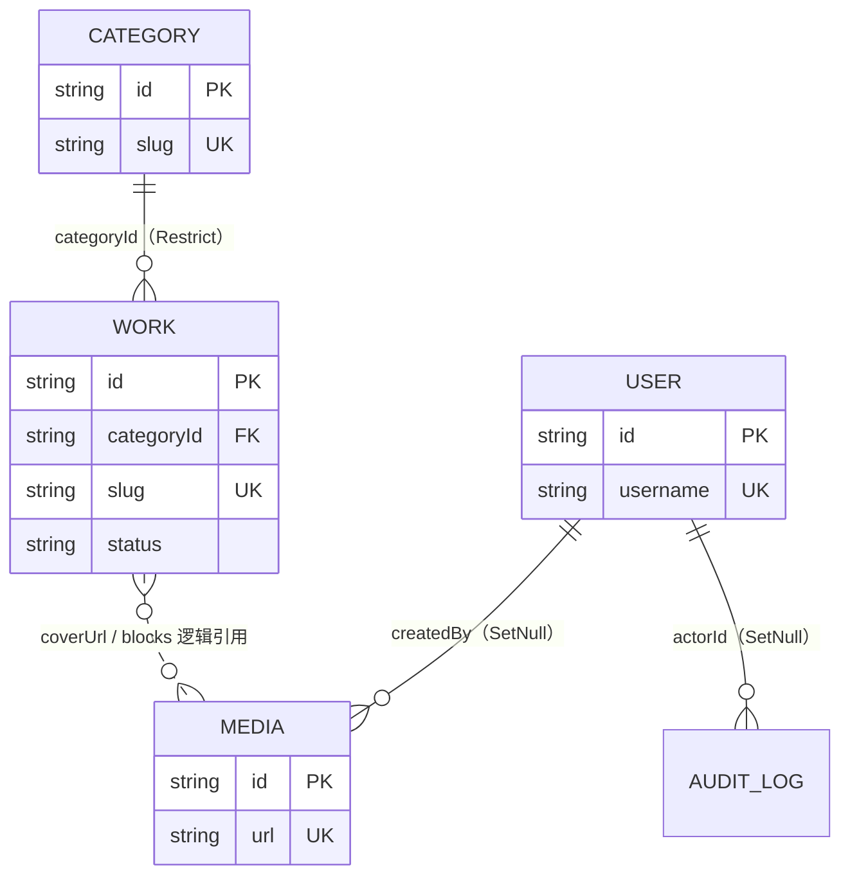

# 07 · 数据模型

> 版本 v0.1 · 2026-11-09 · 状态：待评审
> 技术栈：Prisma 6 + SQLite；Prisma 字段为 camelCase，物理列 snake_case（`@map`）；API JSON 一律 camelCase；时间一律 UTC。

---

## 1. 设计原则：每个取舍换来了什么

本节回答：为什么是 SQLite、为什么内容块存 JSON、为什么单例、为什么不软删除。

| 决策 | 选择 | 理由 | 代价与边界 |
| --- | --- | --- | --- |
| 数据库 | SQLite 单文件 + WAL | 单管理员、作品 < 500、写入 < 1 次/秒；零运维，备份即复制；本地开发零依赖 | 单写者，写事务排队；不能多实例横向扩展；迁移路径见第 10 节 |
| 内容块 | `Work.content` 存 JSON 数组 | 块的顺序、类型、字段天然是文档结构；新增块类型不改表；详情页一次查询取全 | 不能按块内字段建索引或聚合；每次写入整体校验（第 5 节）；单件上限 100 块、256 KB |
| 个人资料 | 单例 `SiteProfile`，`id = 1` + CHECK | 站点只有一位创作者；读多写极少；避免 key-value 化后类型丢失 | 多租户需拆表，属 11 号文档范围 |
| 删除 | P0 硬删除 + UI 二次确认；不做软删除 | 回收站是 P2；软删除会让所有查询都带 `deletedAt IS NULL`，容易漏 | 误删不可恢复，只能靠备份；P1 加 `deletedAt` 时统一封装查询 |
| 媒体引用 | `coverUrl` 与块内 URL 存字符串，不建 FK | 同一文件可被封面、正文、图集多处引用；块是 JSON，无法建 FK | 删除媒体需服务层扫描引用（`MEDIA_IN_USE`）；第 9 节巡检兜底 |
| 枚举 | `TEXT` + CHECK，应用层 Zod 双保险 | SQLite 无原生 enum | 迁移 PostgreSQL 时换 native enum（第 10 节） |

补充规则：

- 主键统一 `cuid()` 字符串，不用自增整数：便于导出与合并数据，迁移 PostgreSQL 不改类型。
- 所有表带 `createdAt` / `updatedAt`；`SiteProfile` 只有 `updatedAt`，因为单例没有创建语义。`updatedAt` 由 Prisma `@updatedAt` 维护，同时是 PATCH 乐观锁的依据。
- JSON 字段在 SQLite 中由 Prisma 以 TEXT 存取，读写两端都必须经 Zod 解析，禁止把未校验的 JSON 直接渲染。

## 2. ERD

本节回答：表之间是什么关系，哪些是数据库强约束、哪些是应用层约束。



实线是数据库外键；`WORK }o..o{ MEDIA` 是虚线，表示只在应用层校验的引用。`SiteProfile`（单例）、`Setting`（KV）与 `AuditLog`（P1）无外键或仅弱关联，未画入；`Session` 由 iron-session 管理，不建表（3.7）。

## 3. 表结构

本节回答：每张表存哪些字段、类型、默认值和边界。

通用约定：`String` 对应 `TEXT`；`Int` 对应 `INTEGER`；`Boolean` 对应 `INTEGER 0/1`；`DateTime` 由 Prisma 按 UTC 存取；`Json` 在 SQLite 中为 TEXT，结构由第 5 节定义。SQL 迁移与原生查询使用物理列 `sort_order`、`published_at`、`featured`；Prisma 字段为 `sortOrder`、`publishedAt`、`isFeatured`，由 `@map` 连接，代码与 API 一律 camelCase（查询参数仍用 `featured`）。

### 3.1 User

| 字段 | 类型 | 约束 | 默认 | 说明 |
| --- | --- | --- | --- | --- |
| id | String | PK | `cuid()` | 主键 |
| username | String | UNIQUE，3–32，`^[a-z0-9_-]+$` | — | 登录名；写入前转小写，禁止空格与中文 |
| passwordHash | String | 非空 | — | bcrypt cost 12；禁止明文、MD5、可逆加密 |
| displayName | String | 1–40 | — | 后台右上角与审计日志显示名 |
| role | String | CHECK `admin`、`editor` | `admin` | v1 只有 admin；预留多角色 |
| sessionEpoch | Int | ≥ 0 | 0 | 扩展字段：改密时 +1，旧 Cookie 立即失效 |
| createdAt | DateTime | 非空 | `now()` | 创建时间 |
| updatedAt | DateTime | 非空 | `@updatedAt` | 更新时间 |
| lastLoginAt | DateTime? | 可空 | `null` | 最近一次登录成功时间；失败不写 |

### 3.2 SiteProfile（单例）

| 字段 | 类型 | 约束 | 默认 | 说明 |
| --- | --- | --- | --- | --- |
| id | Int | PK，CHECK `id = 1` | 1 | 固定 1，插入第二行直接失败 |
| siteName | String | 1–20 | `留白集` | 站点名，前台导航与 title 使用 |
| siteNameEn | String? | ≤ 40 | `LIUBAI` | 英文名或字标副行，可空 |
| ownerName | String | 1–20 | — | 署名，首页最大字号 |
| roleLine | String | ≤ 40 | — | 身份行，如「AIGC 创作者 · 视觉设计」 |
| heroEyebrow | String | ≤ 30 | — | 首页署名上方等宽小字 |
| tagline | String | ≤ 60 | — | 一句介绍，首页 Hero 使用 |
| bio | String | ≤ 5000 | — | 关于页 Markdown；渲染前按白名单清洗 |
| avatarUrl | String? | ≤ 500，`/uploads/` 或 https | `null` | 1:1 头像 |
| email | String | ≤ 120，邮箱格式 | — | 前台 `mailto:` 与页脚大号邮箱 |
| location | String? | ≤ 40 | `null` | 所在地，如「杭州」 |
| availability | String | ≤ 20 | `开放合作` | 首页状态行使用（P1「正在做」）；空字符串则前台隐藏 |
| socials | Json | 数组 ≤ 8，项 `{label,url}` | `[]` | 社交链接；`label` ≤ 12；`url` 为 https 或 mailto |
| footerNote | String | ≤ 120 | — | 页脚短句（版权行上方）；编辑入口在设置页，存储仍在 profile |
| aboutTools | Json | string[] ≤ 12 | `[]` | 关于页「工具」清单（FR-07），每项 ≤ 24 字 |
| timeline | Json | 数组 ≤ 8，项 `{year,title,description?}` | `[]` | 关于页时间线（FR-07）；`year` 为数字，`title` ≤ 40，`description` ≤ 120 |
| updatedAt | DateTime | 非空 | `@updatedAt` | 最后修改时间 |

> i18n 约定：`siteNameEn` 与 `Category.nameEn` 只是英文展示名，不是多语言方案。首版没有 `locale` 列；将来做中英双语时，长正文统一用 `locale` 列或翻译表，不把 `*En` 列堆到 `Work` / `SiteProfile.bio` 上（见 11 §6）。

### 3.3 Category

| 字段 | 类型 | 约束 | 默认 | 说明 |
| --- | --- | --- | --- | --- |
| id | String | PK | `cuid()` | 主键 |
| slug | String | UNIQUE，2–40，同 slug 规则 | — | URL 参数 `?type=` 使用；创建后不可改 |
| name | String | 2–20 | — | 中文名，如「AI 原画」 |
| nameEn | String | ≤ 40 | — | 英文名，如 `AI Painting` |
| description | String | ≤ 80 | — | 首页目录与分类页头的一句话 |
| sortOrder | Int | ≥ 0 | 0 | 升序；相同按 `createdAt` 升序 |
| isVisible | Boolean | 非空 | true | false 时前台列表与导航均不出现，但后台保留 |
| createdAt | DateTime | 非空 | `now()` | 创建时间 |
| updatedAt | DateTime | 非空 | `@updatedAt` | 更新时间 |

作品数不落库：`GET /api/public/categories` 用 `groupBy` 实时统计已发布作品数，避免计数器漂移。

### 3.4 Work

| 字段 | 类型 | 约束 | 默认 | 说明 |
| --- | --- | --- | --- | --- |
| id | String | PK | `cuid()` | 主键 |
| categoryId | String | FK → Category.id，`onDelete: Restrict` | — | 一件作品只能属于一个分类 |
| title | String | 1–80 | — | 标题 |
| slug | String | UNIQUE，2–80，同 slug 规则 | — | 详情页 URL；发布后修改会让旧链接 404，后台需提示 |
| summary | String | ≤ 120 | — | 列表卡与 meta description |
| coverUrl | String | ≤ 500，`/uploads/` 或 https | — | 4:5 封面 |
| coverAlt | String | ≤ 120 | — | 封面替代文本；发布前必填 |
| featuredCoverUrl | String? | ≤ 500，`/uploads/` 或 https | — | 首页精选横版封面；空则回退 `coverUrl` |
| year | Int | 1990–2100 | — | 创作年份，只存年份 |
| tools | Json | string[] ≤ 8，每项 ≤ 24 | `[]` | 工具与模型清单 |
| tags | Json | string[] ≤ 8，每项 ≤ 20 | `[]` | 标签，去重（忽略大小写） |
| role | String? | ≤ 40 | `null` | 担任角色，如「概念 / 生成 / 后期」 |
| client | String? | ≤ 40 | `null` | 客户或项目方；个人作品为空 |
| status | String | CHECK `draft`、`published` | `draft` | 前台只读 published |
| isFeatured | Boolean | 非空 | false | 首页精选；已发布中最多 3 件（应用层事务校验） |
| sortOrder | Int | ≥ 0 | 0 | 升序；相同按 `publishedAt` 降序 |
| content | Json | Block[]，≤ 100 块、≤ 256 KB | `[]` | 内容块，结构见第 5 节 |
| viewCount | Int | ≥ 0 | 0 | 近似浏览量，缓存命中不计数 |
| publishedAt | DateTime? | 可空 | `null` | 首次发布写入；转草稿保留；再次发布不覆盖 |
| createdAt | DateTime | 非空 | `now()` | 创建时间 |
| updatedAt | DateTime | 非空 | `@updatedAt` | 更新时间；PATCH 乐观锁依据 |

### 3.5 Media

| 字段 | 类型 | 约束 | 默认 | 说明 |
| --- | --- | --- | --- | --- |
| id | String | PK | `cuid()` | 主键 |
| url | String | UNIQUE，≤ 500 | — | 对外 URL，`/uploads/YYYY/MM/uuid.ext` |
| storageKey | String | UNIQUE，≤ 255 | — | 相对 `data/uploads` 的路径；删除文件用 |
| originalName | String | ≤ 255 | — | 原始文件名，仅展示与检索，不参与路径 |
| mime | String | 白名单 | — | `image/jpeg`、`image/png`、`image/webp`、`image/avif`、`video/mp4`、`video/webm` |
| size | Int | > 0 | — | 字节数 |
| width | Int? | > 0 | `null` | 图片或视频宽；探测失败为 null |
| height | Int? | > 0 | `null` | 图片或视频高；探测失败为 null |
| createdAt | DateTime | 非空 | `now()` | 上传时间 |
| createdBy | String? | FK → User.id，`onDelete: SetNull` | `null` | 上传者；单管理员下仍记录 |

### 3.6 Setting

| 字段 | 类型 | 约束 | 默认 | 说明 |
| --- | --- | --- | --- | --- |
| key | String | PK，`^[a-z][a-z0-9.]*$` | — | 配置键，点号分层 |
| value | Json | 非空 | — | 值；类型由键约定（下表） |
| updatedAt | DateTime | 非空 | `@updatedAt` | 更新时间 |

v1 允许的键（白名单，PUT 时拒绝未知键）：

| key | 值类型 | 默认 | 用途 |
| --- | --- | --- | --- |
| `site.description` | string ≤ 120 | — | 首页与总览 meta description |
| `seo.keywords` | string[] ≤ 10 | `[]` | meta keywords（低权重，仅补齐） |
| `seo.ogImage` | string | `/og-default.png` | 默认 OG 图，作品页用封面覆盖 |
| `nav` | `{home,works,about}` 布尔 | 全 true | 导航项显隐；「作品」始终保留（03 文档） |
| `footer.icp` | string ≤ 40 | `""` | 备案号；空则不渲染 |

### 3.7 Session 与 AuditLog（P1）

`iron-session` 把会话加密签名后存 Cookie：名 `portfolio_session`，`httpOnly`、`SameSite=Lax`、生产 `Secure`、`Max-Age=604800`；载荷 `{userId,username,role,epoch,issuedAt}`，`epoch` 与 `User.sessionEpoch` 比对，不一致即失效；密钥 `SESSION_SECRET` ≥ 32 字符。服务端无状态、无清理任务，代价是不能单独吊销会话，只能改密 +1 epoch（FR-23）；退出登录由客户端删 Cookie。`AuditLog` 为 P1 可选表：`id`、`actorId?`（FK → User，`SetNull`）、`action` ≤ 40、`entityType` ≤ 20、`entityId?` ≤ 40、`meta` JSON ≤ 4 KB、`ip?` ≤ 45、`createdAt`。P0 不写；P1 与主操作同事务追加，失败只 `console.warn`，不阻断。

## 4. 枚举与约束

本节回答：哪些规则必须由数据库挡住，哪些必须由服务层挡住。

**枚举**（应用层 Zod + 迁移 SQL 的 CHECK 双重约束）：

| 枚举 | 取值 | 使用处 |
| --- | --- | --- |
| WorkStatus | `draft`、`published` | Work.status |
| Role | `admin`、`editor` | User.role |
| BlockType | 第 5 节 10 种 | Work.content[].type |
| VideoProvider / BulkAction | `bilibili`、`youtube`、`file` / `publish`、`draft`、`delete` | video 块 / 批量接口 |

**slug 规则**（BR-01）：

- 正则 `^[a-z0-9]+(?:-[a-z0-9]+)*$`；长度 2–80（分类 2–40）；不含首尾连字符、不含连续连字符。
- 中文标题由 `pinyin-pro` 转写，取前 80 字符，去掉标点；冲突依次追加 `-2` 至 `-99`，仍冲突返回 `SLUG_CONFLICT`。
- 保留字禁止：`admin`、`api`、`works`、`about`、`new`、`edit`、`login`、`logout`、`sitemap`、`robots`、`uploads`、`_next`、`favicon.ico`。
- 比较时统一小写；数据库唯一索引区分大小写，因此写入前必须 `toLowerCase()`（第 9 节补查大小写重复）。

**长度与数量**（BR-08）：标题 ≤ 80；摘要 ≤ 120；alt ≤ 120；标签 ≤ 8 个、每个 ≤ 20；工具 ≤ 8 个、每个 ≤ 24；图集 2–6 张；内容块 ≤ 100；社交链接 ≤ 8；时间线 ≤ 8。

**发布校验**（BR-02）：`title`、`slug`、`categoryId`、`coverUrl`、`coverAlt`、`summary`、`year`、`content.length ≥ 1` 全部满足才允许 `status = published`；缺项返回 422 并列出字段。取消发布不受限制。

**删除与级联**：

| 关系 | 策略 | 理由 |
| --- | --- | --- |
| Work.categoryId → Category | `Restrict` | 有作品时禁止删除分类（BR-03 / AC-15），返回 `CATEGORY_IN_USE` |
| Media.createdBy → User | `SetNull` | 删管理员不删媒体 |
| AuditLog.actorId → User | `SetNull` | 保留日志 |
| Work 删除 | 硬删除 | 同时不删除封面媒体，可能被其他作品复用 |
| Category 删除 | 硬删除，先检查作品数 | 事务内 count 后删除，防竞态 |

**唯一约束**：`User.username`、`Category.slug`、`Work.slug`、`Media.url`、`Media.storageKey`、`Setting.key`；`SiteProfile.id = 1`。冲突统一映射为 409：slug 用 `SLUG_CONFLICT`，其余用 `VALIDATION_ERROR` 并指出字段。

**CHECK 约束**（写在首个迁移的 SQL 中，Prisma schema 不支持）：`User.role IN ('admin','editor')`、`session_epoch >= 0`；`SiteProfile.id = 1`；`Work.status IN ('draft','published')`、`year BETWEEN 1990 AND 2100`、`view_count >= 0`、`sort_order >= 0`；`Category.sort_order >= 0`；`Media.size > 0`，宽高为 NULL 或 > 0；`Setting.key GLOB '[a-z]*'`。

事务边界：发布、取消发布、批量操作（逐条事务）、排序（整批事务）、删除分类（count + delete 同事务）、改密（更新 hash + epoch 同事务）。内容块与 JSON 字段的校验在事务前完成。

## 5. 内容块 Block

本节回答：正文的 JSON 长什么样，新增类型时怎么不破坏旧数据。

每个块都有三个通用字段；块内 `id` 只用于 React key 与拖拽排序，不要求全局唯一：

| 字段 | 类型 | 约束 | 说明 |
| --- | --- | --- | --- |
| id | string | `^b_[a-z0-9]{6,12}$` | 块 id；服务端缺省时生成 |
| type | string | 下列 10 种之一 | 未知类型只读降级（见本节末） |
| version | number | 当前 `1` | 结构版本；破坏性变更时 +1 |

| 类型 | 专属字段 | 约束 |
| --- | --- | --- |
| `paragraph` | `text` | Markdown 行内语法；≤ 2000 字；禁止 HTML 标签 |
| `heading` | `level`、`text` | `level` 为 2 或 3；`text` ≤ 80 |
| `image` | `url`、`alt`、`caption?`、`width?`、`height?` | `alt` 必填 ≤ 120；`url` 为 `/uploads/` 或 https；`caption` ≤ 160 |
| `gallery` | `images[]` | 2–6 项，每项 `{url,alt,caption?}`；不混入视频 |
| `video` | `provider`、`url`、`title?`、`poster?` | provider 见第 4 节；B 站与 YouTube 存页面 URL，由前端按 ID 生成 iframe；`file` 存 `/uploads/` |
| `audio` | `url`、`title`、`duration?` | `url` 为 `/uploads/` 或 https；`duration` 为整数秒 |
| `quote` | `text`、`cite?` | `text` ≤ 300；`cite` ≤ 60 |
| `prompt` | `model?`、`text`、`negative?`、`params?`、`collapsed?` | `text` ≤ 4000；`params` 为扁平对象，≤ 20 键；默认折叠 |
| `link` | `url`、`title`、`description?` | 仅 https；`title` ≤ 80；`description` ≤ 120 |
| `divider` | 无 | 仅渲染 1 px 分隔线 |

统一 JSON 示例（每个块一行，便于复制）：

```json
{"id":"b_01","type":"paragraph","version":1,"text":"这张图从一张潮汐表开始。第一版只保留了岸线的形状。"}
{"id":"b_02","type":"heading","version":1,"level":2,"text":"制作过程"}
{"id":"b_03","type":"image","version":1,"url":"/uploads/2026/11/9f3c2a1b.webp","alt":"暖灰色海面上的一道白色浪线","caption":"初稿，1024 × 1280","width":1024,"height":1280}
{"id":"b_04","type":"gallery","version":1,"images":[{"url":"/uploads/2026/11/a1.webp","alt":"岸线局部"},{"url":"/uploads/2026/11/a2.webp","alt":"色稿对比","caption":"三种暖灰"}]}
{"id":"b_05","type":"video","version":1,"provider":"bilibili","url":"https://www.bilibili.com/video/BV1xx411c7mD","title":"生成过程 42 秒","poster":"/uploads/2026/11/poster.webp"}
{"id":"b_06","type":"audio","version":1,"url":"/uploads/2026/11/low-tide.mp3","title":"低频海 · 试听","duration":96}
{"id":"b_07","type":"quote","version":1,"text":"海面没有一处是重复的。","cite":"创作笔记"}
{"id":"b_08","type":"prompt","version":1,"model":"Midjourney v6.1","text":"a quiet shoreline at low tide, muted warm grey, soft overcast light --ar 4:5","negative":"text, watermark, oversaturation","params":{"ar":"4:5","stylize":250,"seed":184271},"collapsed":true}
{"id":"b_09","type":"link","version":1,"url":"https://example.com/tide-data","title":"潮汐表原始数据","description":"公开潮汐数据，CC BY 4.0"}
{"id":"b_10","type":"divider","version":1}
```

**版本与降级**：

- 读取：渲染器按 `type` 分发；`version ≤ 1` 走 v1 渲染器，`version > 1` 或未知 type 渲染占位块——48 px 册页线 + 一句「此内容块暂不支持，请升级站点」，不输出原始 JSON，不抛错，其余块照常渲染。
- 写入：新增块只接受已注册类型与 `version = 1`；编辑旧作品时，客户端原样回传的未知块按 `id` 与旧内容比对，一致则允许保存（避免一次编辑丢掉未来的块），不一致返回 422。
- 演进：破坏性改字段时把 `version` 升到 2，渲染器同时支持 1 和 2，再用脚本批量迁移；不得在 v1 内改名或改变字段含义。
- 计数口径：需求文档写「11 种」；实际枚举 10 种，第 11 个分支是「未知类型占位」，渲染器必须实现，所以实现清单仍按 11 个分支验收。

补充：`paragraph` 与 `quote` 的 Markdown 只允许强调、行内代码、链接；`<script>`、`<iframe>`、`<style>`、事件属性一律在写入与渲染两端清除（BR-09）。

## 6. 索引与查询模式

本节回答：哪些查询必须走索引，为什么是这些列组合。

| 索引 | 列 | 服务的查询 |
| --- | --- | --- |
| `Work_slug_key` | `slug` UNIQUE | 详情页按 slug 取单件 |
| `Work_status_publishedAt_idx` | `status, publishedAt` | 总览、sitemap、上一件/下一件 |
| `Work_categoryId_sortOrder_idx` | `categoryId, sortOrder` | 分类页与筛选列表 |
| `Work_isFeatured_sortOrder_idx` | `isFeatured, sortOrder` | 首页精选 |
| `Work_updatedAt_idx` | `updatedAt` | 后台最近编辑（补充，FR-13） |
| `Category_isVisible_sortOrder_idx` | `isVisible, sortOrder` | 首页目录、导航下拉 |
| `Media_createdAt_idx` | `createdAt` | 媒体库倒序分页 |

| 查询 | 条件与排序 | 命中索引 | 备注 |
| --- | --- | --- | --- |
| 首页精选 | `status='published' AND isFeatured=1`，`sortOrder ASC, publishedAt DESC`，LIMIT 3 | `Work_isFeatured_sortOrder_idx` | 不足 3 件时用最新作品补齐，二次查询限 3 条 |
| 总览与分类 | `status='published'`，可选 `categoryId`，`sortOrder ASC, publishedAt DESC`，LIMIT 12 OFFSET n | 分类用 `categoryId, sortOrder`；全部用 `status, publishedAt` | 深分页 ≤ 500 件，OFFSET 可接受 |
| 详情 | `slug = ?` | unique | 同时查 `status`，草稿返回 404 |
| 上一件/下一件 | 全站已发布，按 `sortOrder, publishedAt` 排序 | `Work_status_publishedAt_idx` | 取相邻两条；边界返回 null |
| 后台列表 | 可选 `status`、`categoryId`，`updatedAt DESC` | `Work_updatedAt_idx` | 标题搜索为全表扫描，≤ 500 件可接受 |
| 媒体库 | `ORDER BY createdAt DESC` | `Media_createdAt_idx` | 可按 mime 前缀过滤，不额外建索引 |

SQLite 说明：`status` 基数低，单列索引意义不大，所以与 `publishedAt` 组合；若后续数据量增长，可在迁移中加部分索引 `CREATE INDEX ... ON works(sort_order, published_at) WHERE status='published'`（Prisma schema 不支持，写在 SQL 迁移里）。

## 7. 种子数据规格

本节回答：首次启动后站点长什么样，如何保证可重复执行。

- 管理员 1 个：`username = process.env.ADMIN_USERNAME ?? 'admin'`；密码只从 `ADMIN_PASSWORD` 读取，未设置则脚本退出并提示，不写默认密码；bcrypt cost 12；`displayName = '留白'`。
- 分类 6 个（固定 slug，`sortOrder` 01–06，全部可见）：

| slug | name | nameEn |
| --- | --- | --- |
| `ai-painting` | AI 原画 | AI Painting |
| `ai-video` | AI 视频 | AI Video |
| `ai-novel` | AI 小说 | AI Novel |
| `ai-music` | AI 音乐 | AI Music |
| `ai-app` | AI 应用 | AI App |
| `ai-agent` | 智能体 | AI Agent |

- 作品 12 件，分布如下（`featured` 3 件、`draft` 2 件、每类至少 1 件）：

| # | 标题 | 分类 | 状态 | 精选 | 内容块 |
| --- | --- | --- | --- | --- | --- |
| 01 | 潮汐 | ai-painting | published | ✅ | paragraph、image、prompt、quote |
| 02 | 山纹 | ai-painting | published | — | paragraph、gallery、prompt |
| 03 | 静物练习 | ai-painting | published | — | paragraph、image |
| 04 | 长夜漫游 | ai-video | published | ✅ | paragraph、video、quote |
| 05 | 城市呼吸 | ai-video | published | — | paragraph、video、link |
| 06 | 纸上的城市 | ai-novel | published | ✅ | paragraph、heading、image、prompt |
| 07 | 第七次涨潮 | ai-novel | published | — | paragraph、quote、audio |
| 08 | 低频海 | ai-music | published | — | paragraph、audio、prompt |
| 09 | 采样练习 | ai-music | published | — | paragraph、audio |
| 10 | 留白清单 | ai-app | published | — | paragraph、image、link |
| 11 | 字体试衣间 | ai-app | draft | — | paragraph、image |
| 12 | 值班编辑 | ai-agent | draft | — | paragraph、prompt |

- 种子行为：按 `slug` 与 `key` upsert，可重复执行；`SEED_RESET=1 pnpm prisma db seed` 先清空 works/media 再灌入；`publishedAt` 取最近 180 天内的 UTC 时间，`sortOrder` 按表中顺序 10、20、30…，避免同值排序不稳定。`ai-agent` 只有草稿，用于演示「分类为空」的前台空态（AC-07）。
- 个人资料：`siteName`「留白集」、`ownerName`「留白」、`roleLine`「AIGC 创作者 · 视觉设计」、`tagline`「用模型做原画、影像与小说，也记录过程。」、`availability`「开放合作」、`aboutTools` 至少 5 项（Midjourney、ComfyUI、Runway、Suno、Cursor）、`timeline` 3 条、`email` 用 `OWNER_EMAIL` 或 `hello@example.com`。

## 8. 迁移与备份

本节回答：数据库怎么升级，坏了怎么在 10 分钟内恢复。

**迁移**：

```bash
pnpm prisma migrate dev --name init                              # 开发：生成迁移并应用
pnpm prisma migrate dev --create-only --name check_constraints   # 手写 CHECK 与部分索引
pnpm prisma migrate deploy                                       # 生产：只应用
pnpm prisma db seed                                              # 种子
```

- 迁移文件提交后不得修改，修正用新迁移；部署前备份，失败不回滚文件，改用备份恢复。
- SQLite 的 `ALTER TABLE` 能力有限，删列或改类型用「建新表 → 复制 → 改名」的官方模式。

**运行参数**：连接串加 `?connection_limit=1`；每个连接执行 `PRAGMA journal_mode = WAL; PRAGMA synchronous = NORMAL; PRAGMA busy_timeout = 5000; PRAGMA foreign_keys = ON;`。

**每日备份**（03:15，保留 14 天）：

```bash
sqlite3 data/app.db ".backup 'backups/app-$(date +%F).db'"
tar -czf "backups/uploads-$(date +%F).tar.gz" data/uploads
find backups -type f -mtime +14 -delete
sqlite3 "backups/app-$(date +%F).db" "PRAGMA integrity_check;"
```

- 不要 `cp` 正在写入的 `.db`（WAL 未合并会损坏），必须 `.backup` 或 `VACUUM INTO`；备份与 uploads 至少一份在另一块磁盘；Windows 用 `sqlite3.exe`，生产用 cron 或 systemd timer。

**恢复**：

1. 停应用，避免写入。
2. `cp backups/app-YYYY-MM-DD.db data/app.db`，解包 uploads 到 `data/uploads`。
3. `pnpm prisma migrate deploy`，确认 schema 与备份版本一致。
4. `PRAGMA integrity_check` 返回 `ok`，启动应用，抽查 3 件作品与 1 次上传。

## 9. 数据完整性检查清单

本节回答：没有数据库约束兜底的地方，怎么发现脏数据。

| 检查 | 方法 | 处理 |
| --- | --- | --- |
| 孤儿媒体 | `Media.url` 不在任何 `Work.coverUrl` 或 `content` 文本中出现 | 报告；30 天后清理文件与行 |
| 丢失文件 | 遍历 `Media.storageKey`，文件不存在 | 标记并补传；前台降级占位 |
| slug 大小写冲突 | `SELECT lower(slug), count(*) FROM works GROUP BY 1 HAVING count(*)>1` | 合并或改 slug；写入层已强制小写 |
| 发布缺字段 | `status='published'` 且 title、slug、category、cover、coverAlt、summary、year 为空，或 `json_array_length(content)=0` | 自动转草稿并记录 |
| 发布时间异常 | `status='published' AND (publishedAt IS NULL OR publishedAt > now)` | 补时间或转草稿（不支持定时发布） |
| JSON 损坏 | `json_valid(content)=0` 或 `json_valid(tags)=0` | 从备份恢复该行；禁止手工拼接 JSON |
| 精选超限 | 已发布 `isFeatured=1` 计数 > 3 | 保留 `sortOrder` 最小 3 件，其余取消 |
| 时区 | 抽查 `publishedAt` 与 `createdAt` 的 UTC 偏移为 0；展示层再转 `Asia/Shanghai` | 统一用 `new Date()` 写入，禁止字符串拼本地时间 |

巡检脚本 `scripts/check-data.ts` 只读，输出 Markdown 报告；CI 在种子后跑一次，失败不阻断构建但必须修复。

## 10. 迁移到 PostgreSQL 的差异

本节回答：如果作品量或多实例需求超出 SQLite，哪些地方必须改。

| 主题 | SQLite 现状 | PostgreSQL 目标 |
| --- | --- | --- |
| JSON | `Json` 存 TEXT，无索引 | `JSONB`；`content` 可加 GIN（仅在需要按块检索时） |
| 枚举 | TEXT + CHECK | 原生 `enum` 类型（`WorkStatus`、`Role`），迁移时先建类型再 `USING` 转换 |
| 大小写 | 唯一索引区分大小写，靠写入小写 | 唯一索引加 `lower(slug)` 或 `citext`；避免两套规则 |
| 时间 | Prisma DateTime，UTC | `timestamptz`；禁止 `timestamp without time zone` |
| 并发 | 单写者，`busy_timeout` 排队 | MVCC；多实例需连接池（PgBouncer），限流从内存改 Redis |
| 排序 | NULL 行为默认 | 显式 `NULLS LAST`，避免 `publishedAt` 为空排到前面 |
| 备份 | `.backup` + tar | `pg_dump -Fc` + 对象存储；uploads 仍单独备份 |

迁移步骤：改 `provider` → 新建空库 → `migrate deploy` → 写一次性脚本按表复制（JSON 字段 `JSON.parse` 后写入 JSONB）→ 校验行数与抽样 → 切连接串 → 保留 SQLite 只读一周。

